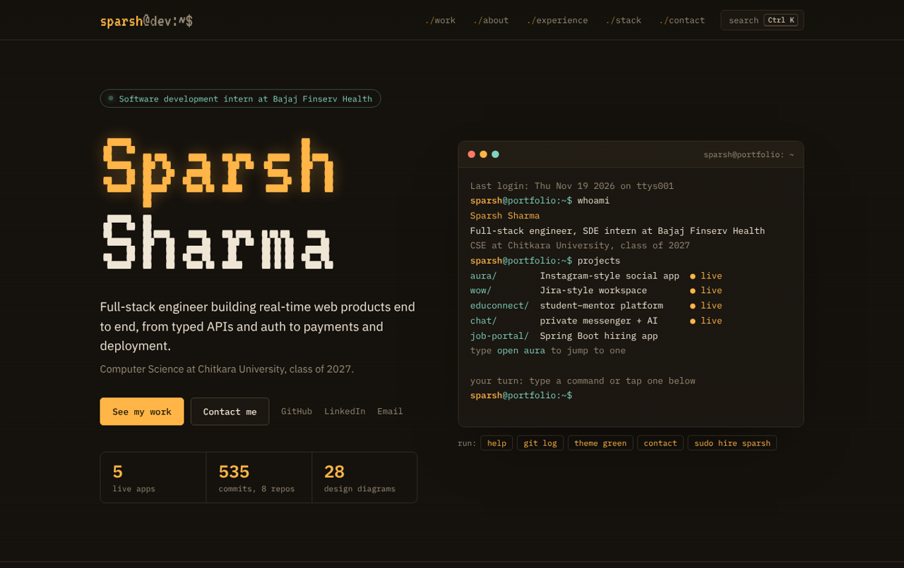

# Sparsh Sharma — portfolio

A terminal-themed developer portfolio built with **React 19** and **Vite**. It features my projects with real screenshots and architecture diagrams, a working terminal, a command palette and three colour themes.



## Features

- **Interactive terminal** in the hero. It types `whoami` and `projects` on load, then accepts commands such as `help`, `open wow`, `git log`, `theme green` and `sudo hire sparsh`.
- **Project windows** with tabs for app screenshots, architecture and sequence diagrams, ERDs, and a `README.md` case study (problem, how it works, known limits, what's next). Click any image to enlarge it.
- **Command palette** on <kbd>Ctrl</kbd>/<kbd>⌘</kbd> + <kbd>K</kbd> to jump to any section, project, live demo, link or theme.
- **Three themes**: amber phosphor (default), green phosphor and a light paper theme. The choice is remembered.
- **Commit-activity heatmap** and a **project archive** built from the git history of each repo.
- **Stack with context**: where each skill was used and since when, plus a `cloc` summary of the code.
- Responsive down to small phones, keyboard accessible, and respects `prefers-reduced-motion`.

## Tech

| Area | Choice |
| --- | --- |
| UI | React 19 (function components, hooks, context) |
| Build | Vite 7 with `@vitejs/plugin-react` |
| Styling | Plain CSS with custom properties for theming; no UI library |
| Fonts | IBM Plex Sans, IBM Plex Mono and VT323 from Google Fonts |
| Quality | ESLint 9 with the React Hooks and React Refresh plugins |

The production bundle is about 74 KB of gzipped JavaScript (including React) and 5 KB of CSS.

## Getting started

Requires Node.js 20.19 or newer.

```bash
npm install
npm run dev       # start the dev server at http://localhost:5173
npm run build     # production build in dist/
npm run preview   # serve the production build locally
npm run lint      # run ESLint
```

## Project structure

```
├── index.html               # page shell, meta tags and fonts
├── public/
│   ├── favicon.svg
│   └── assets/              # project screenshots and diagrams (WebP)
└── src/
    ├── main.jsx             # entry point
    ├── App.jsx              # layout, shared state and keyboard shortcuts
    ├── components/          # one component per section, each with its own CSS
    │   └── terminal/        # terminal commands and output helpers
    ├── context/             # shared actions (theme, scrolling, palette, lightbox)
    ├── data/                # all text, numbers and links shown on the site
    ├── hooks/               # theme, scroll, local time and reduced-motion hooks
    ├── lib/                 # small browser helpers and palette items
    └── styles/global.css    # design tokens, themes and shared styles
```

## Editing content

Everything shown on the site lives in `src/data/`:

- `profile.js` — name, role, links, availability and the hero numbers
- `projects.js` — featured projects, their screenshots, case studies and the archive table
- `activity.js` — monthly commit counts for the heatmap
- `stack.js` — skills, where they were used, and the `cloc` numbers
- `experience.js` and `capabilities.js` — the timeline and the "what I bring" cards

Screenshots go in `public/assets/` and are referenced from `projects.js`.

## Deploying

**Vercel:** import this repository, keep the detected **Vite** preset, and deploy. No configuration is needed.

**GitHub Pages:** set `base: '/<repo-name>/'` in `vite.config.js`, run `npm run build`, and publish the `dist/` folder.

## Contact

Sparsh Sharma · [sparshs1790@gmail.com](mailto:sparshs1790@gmail.com) · [LinkedIn](https://www.linkedin.com/in/sparsh-sharma-7a4449296) · [GitHub](https://github.com/sparshsharma81)
